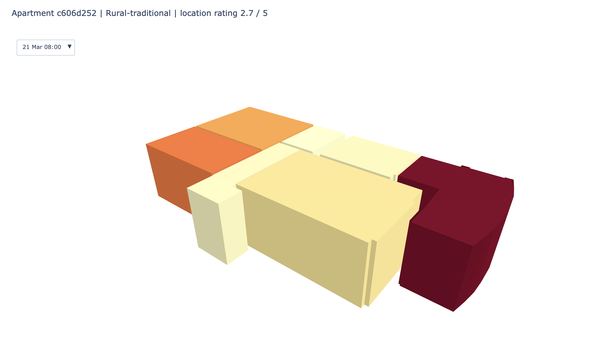

# Daylight Floorplans

An interactive 3D view of apartment rooms colored by daylight, plus a model predicting daylight from layout.

## Dataset

Credits to Standfest, M., Franzen, M., Schröder, Y., Gonzalez Medina, L., Villanueva Hernandez, Y., Buck, J. H., Tan, Y.-L., Niedzwiecka, M., & Colmegna, R. (2023). *Swiss Dwellings: A large dataset of apartment models including aggregated geolocation-based simulation results covering viewshed, natural light, traffic noise, centrality and geometric analysis* (v3.0.0) [Data set]. Zenodo. https://doi.org/10.5281/zenodo.7788422

Licensed under CC BY 4.0. Location ratings were provided by Fahrländer Partner AG.

## Setup

1. install requirements in requirements.txt
2. download this repo
3. download the dataset from https://zenodo.org/records/7788422, extract it, and move all .csv into the root of the repo

## Commands

3D apartment view: python3 plot_apartment.py (and apartment_id if you are looking for a specific apartment, otherwise it will generate a random apartment). It opens apartment.html in your browser.

Daylight by segment chart: python3 daylight_by_segment.py. It prints a table and saves daylight_by_segment.png.

Daylight model: python3 predict_daylight.py. It prints the R² score and feature importances.

